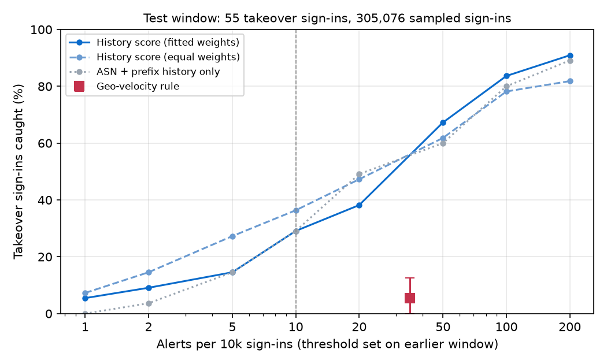
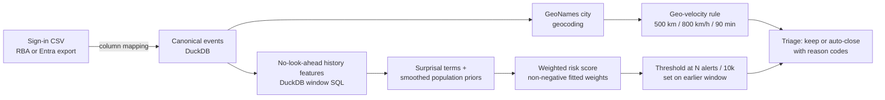

# Impossible-Travel Alert Triage

Scores Entra ID / Microsoft 365-style sign-in logs on each user's own ASN, IP-prefix, country and device history, so SOC analysts can auto-close impossible-travel alerts from VPNs, mobile carriers and cloud desktops and catch the account takeovers the rule misses.

## Results

- **Built impossible-travel alert triage for SOC analysts that caught 29.1% of account takeovers** at 10 alerts per 10k logins vs 5.5% for the rule, in DuckDB
- **Caught 10x more account takeovers than the geo-velocity rule at the same alert volume** (54.5% vs 5.5%) by scoring per-user ASN history in DuckDB SQL
- **Auto-closed 97.7% of 1,061 impossible-travel rule alerts** on VPN, carrier and cloud hops, each with plain reason codes, using Python and pandas
- **Found 52 of 55 account takeovers had no sign-in in the prior 90 minutes**, so the impossible-travel rule could never fire, using DuckDB window SQL



## Why it matters

Impossible-travel rules such as [Elastic's Entra ID rule](https://detection.fyi/elastic/detection-rules/integrations/azure/initial_access_entra_id_signin_impossible_travel/) fire on VPN egress, mobile carriers that geolocate to distant hubs and cloud desktop ASNs, and one mis-geolocated carrier hop can take [a full investigation to clear](https://www.dropzone.ai/blog/investigation-reference-78456-how-an-ai-analyst-reasoned-through-an-atypical-travel-alert). Blanket exclusions for those networks open a hole for real account takeovers.

**Stack:** Python, DuckDB (SQL window functions), pandas, NumPy, SciPy, scikit-learn, Hypothesis, pytest, matplotlib, GeoNames

## Quickstart

```bash
pip install -r requirements.txt
python3 -m traveltriage fetch --out data/ --users 200000
python3 -m traveltriage evaluate --data data/ --budget-per-10k 10 --out results/eval.json
```

`fetch` downloads the 1.1 GB RBA dataset and GeoNames cities and samples users in DuckDB; `evaluate` writes
`results/eval.json`, the fitted model and the **[interactive alert page](docs/index.html)**
([`docs/index.html`](docs/index.html)): example rule alerts side by side with the scorer's keep/auto-close verdict and reason codes.

## How it works



1. **Data** (`traveltriage fetch`). Downloads the [RBA login dataset](https://zenodo.org/record/6782156)
   (33M login attempts synthesized from a real SSO service, CC BY 4.0) and the GeoNames `cities1000`
   table. In two DuckDB passes over the 9 GB CSV it keeps every user with a labelled account takeover
   plus a deterministic hash-based random sample of users (`--users`). Only the random sample is used to
   measure alert rates and population priors, so over-sampling takeover users cannot flatter the numbers.
2. **Baseline rule** (`traveltriage/geo.py`). For each successful sign-in, look back over the same user's
   successful sign-ins in the previous 90 minutes and fire if one is at least 500 km away at an implied
   speed above 800 km/h. Cities are matched to GeoNames by country, name and region; sign-ins without a
   city fall back to the population-weighted country centroid.
3. **History features** (`traveltriage/features.py`). DuckDB window functions whose frames end 1 ms
   before each event (`RANGE BETWEEN UNBOUNDED PRECEDING AND 1 PRECEDING`), so a sign-in only sees
   strictly earlier events:
   per-user counts of prior successful sign-ins in total and on the same ASN, /24 (IPv6 /48) prefix,
   country, user agent and OS; failed sign-ins on the account in the prior 24 h; and population counts of
   distinct sampled users already seen on the same ASN / prefix / country / user agent / OS, plus distinct
   users with failed sign-ins from the same IP.
4. **Score** (`traveltriage/scoring.py`). Each attribute becomes a surprisal term
   `-log((user count + α·p_pop) / (user sign-ins + α))`, where `p_pop` is the smoothed share of sampled
   users already seen on that value. A cold-start user on a carrier ASN that a quarter of the population
   uses scores low; an established user on a never-seen hosting ASN scores high. Term weights are fitted
   with logistic regression on the calibration window; an equal-weight variant uses no labels at all.
5. **Threshold and evaluation** (`traveltriage/evaluate.py`). The alert threshold is the score quantile
   that gives the requested alerts per 10k sign-ins on the calibration window. All reported numbers come
   from the later test window. 95% intervals come from a bootstrap that resamples users (1,000 draws).
6. **Reason codes.** Kept alerts list the largest score contributions (`new ASN for user: AS3280 (1 of
   126,402 sampled users)`, `8 failed sign-ins on account in prior 24h`); auto-closed rule alerts list the
   familiarity that closed them (`ASN AS12392 seen 227x before for user`).

## Scoring an Entra ID sign-in export

`mappings/entra_signin.json` maps the columns of the Entra ID portal CSV export
(`Date (UTC)`, `User ID`, `IP address`, `Location` as `City, State, Country`,
`Autonomous system number`, `Status`, `User agent`, `Operating System`, `Browser`, `Request ID`)
onto the canonical schema. Copy and edit it for other exports (Graph `signIns` JSON flattened to CSV,
SIEM exports): each canonical field names its source column.

```bash
python3 -m traveltriage fetch --out data/ --geonames-only     # city coordinates only, a few seconds
python3 scripts/make_entra_example.py                          # regenerate the example export
python3 -m traveltriage score --input examples/entra_signins_example.csv \
    --mapping mappings/entra_signin.json --model results/model.json --out alerts.csv
```

`alerts.csv` has one row per alert or rule hit with `score`, `verdict` (`alert`, `auto-closed rule
alert`), `reasons` and the original `Request ID` as `source_id`. `results/model.json` holds the fitted
weights and threshold; `results/rule_thresholds.json` exports both the geo-velocity thresholds and the
score threshold for re-implementation in a SIEM.

## Full results

RBA dataset: 4,304,857 users in the source; `fetch --users 200000` keeps a random sample of 200,000 users plus
every user with a labelled takeover (138 users, 140 successful takeover sign-ins in total). Successful sign-ins:
warm-up 2020-02-03 to 2020-04-01, calibration 2020-04-01 to 2020-08-01 (182,628 sampled sign-ins, 52 takeovers),
test 2020-08-01 to 2021-02-28 (305,076 sampled sign-ins, **55 takeover sign-ins on 54 users**). All numbers below
are from the test window (`results/eval.json`). 95% intervals come from a bootstrap over users.

**At a budget of 10 alerts per 10k sign-ins** (threshold set on the calibration window):

| Detector | Takeovers caught | Recall (95% CI) | Alerts per 10k sign-ins (95% CI) | Average precision |
|---|---|---|---|---|
| Geo-velocity rule (≥500 km, >800 km/h, 90 min) | 3 / 55 | 5.5% (0.0–12.5%) | 34.8 (22.5–56.4) | 0.0003 |
| **History score, fitted weights (primary)** | **16 / 55** | **29.1% (17.9–41.8%)** | **11.7 (10.2–13.4)** | **0.032** |
| History score, equal weights (no labels) | 20 / 55 | 36.4% (23.6–49.1%) | 12.8 (10.7–15.1) | 0.034 |
| ASN + IP-prefix history only | 16 / 55 | 29.1% (18.2–41.1%) | 14.7 (12.6–17.4) | 0.023 |

The primary score's recall minus the rule's recall: +23.6 points (95% CI +10.7 to +36.4).

**At the rule's own alert rate** (threshold set to the rule's 30.8 alerts per 10k on the calibration window):

| Detector | Takeovers caught | Recall (95% CI) | Alerts per 10k |
|---|---|---|---|
| Geo-velocity rule | 3 / 55 | 5.5% (0.0–12.5%) | 34.8 |
| History score, fitted weights | 30 / 55 | 54.5% (40.7–67.3%) | 28.4 |
| History score, equal weights | 33 / 55 | 60.0% (47.3–72.7%) | 36.4 |

**Triage of rule alerts** (rule alerts on sampled users in the test window; auto-close = score at or below
the 10-per-10k threshold):

| Score | Rule alerts | Auto-closed (95% CI) | Takeovers the rule caught | Of those, lost by auto-closing |
|---|---|---|---|---|
| Fitted weights | 1,061 | 97.7% (97.1–98.7%) | 3 | 2 |
| Equal weights | 1,061 | 98.1% (97.0–99.6%) | 3 | 1 |

**Why the rule misses takeovers** (test window, 55 takeover sign-ins): 52 had no successful sign-in by the same
user in the preceding 90 minutes, so there is nothing to compare against; 12 had no prior sign-in at all;
48 came from a country and 50 from an ASN the user had never signed in from.

## Tests

```bash
python3 -m pytest -q
```

- `tests/test_no_lookahead.py`: a Hypothesis property test. It builds random sign-in histories, then shuffles
  every attribute of the events after a random cut time, drops some of them and shuffles row order. All
  features, the rule flag and the score of every event up to the cut must be unchanged. A second test checks
  that events with the same timestamp never see each other. Extending the SQL window frame past the current
  event makes both fail.
- `tests/test_rule_and_scoring.py`: rule geometry (distance, speed, 90-minute window, failed sign-ins ignored),
  familiar vs new ASN scoring and reason codes, cold-start priors, budget thresholds.
- `tests/test_evaluate_e2e.py`: the full `evaluate` pipeline on a synthetic dataset.
- `tests/test_entra_mapping.py`: the Entra column mapping and the `score` CLI on the example export.

## Design notes

- **No look-ahead by construction.** Every feature is a DuckDB window aggregate whose frame ends 1 ms before the
  event, and population counts use "first seen" markers per (value, user), so a count can only include events
  strictly earlier in time. The property test guards this.
- **Population priors from the random sample only.** All takeover users are added to the sample, so they are
  over-represented. Population counts (users on an ASN, users failing from an IP) and alert rates use only the
  random sample, so that over-sampling cannot make attacker infrastructure look common or alert rates look low.
- **Smoothed priors for cold start.** A user's first sign-in is scored against how common the ASN, prefix,
  country and device are across sampled users, so a first sign-in from the national carrier is unremarkable
  and a first sign-in from an ASN no one uses is not.
- **Thresholds are budgets.** Analysts staff for a number of alerts, not a probability. The threshold is the score
  quantile that yields N alerts per 10k sign-ins on an earlier window; the realised rate on the later window is
  reported (11.7 for a target of 10 here, from drift between windows).
- **Fitted weights are non-negative.** Each term measures surprise or attack pressure; a negative weight would mean
  "more unusual is safer" and would make reason codes misleading. The fit is a class-balanced logistic loss with
  a small L2 penalty, solved with SciPy L-BFGS-B under a sign constraint.
- **Variant selection without the test window.** Fitted weights are fit on the first half of the calibration
  window and all variants are compared on its second half (26 takeovers). The fitted variant won (6/26 vs 5/26
  for equal weights), so it is the primary result even though the equal-weight score did better on the test
  window. With this few labels, the two are statistically indistinguishable.
- **Geocoding.** RBA cities are matched to GeoNames `cities1000` by country, name and region (52% of sign-ins);
  sign-ins without a city use the population-weighted country centroid, as most IP-geolocation databases do.

## Project layout

```
traveltriage/
  fetch.py      download RBA + GeoNames, sample users in DuckDB
  geo.py        GeoNames geocoding and the geo-velocity rule (SQL)
  features.py   no-look-ahead per-user and population history features (SQL)
  scoring.py    surprisal terms, weighted score, reason codes
  evaluate.py   windows, fitting, budget thresholds, bootstrap CIs -> results/eval.json
  report.py     docs/index.html alert page
  mapping.py    export column mapping (Entra ID)
  cli.py        fetch | evaluate | score
mappings/entra_signin.json      Entra ID sign-in CSV mapping
examples/entra_signins_example.csv   synthetic 300-user export (scripts/make_entra_example.py)
scripts/plot_results.py         docs/recall_vs_budget.png from results/eval.json
results/                        eval.json, model.json, rule_thresholds.json
```

## Data and credits

- RBA dataset: S. Wiefling, P. R. Jørgensen, S. Thunem, L. Lo Iacono, "Pump Up Password Security! Evaluating and
  Enhancing Risk-Based Authentication on a Real-World Large-Scale Online Service", ACM TOPS 2023.
  [Zenodo 6782156](https://zenodo.org/record/6782156), CC BY 4.0. The data is synthesized from a real SSO
  service's logins; its README notes that cities and regions were derived from generated IP addresses.
- GeoNames `cities1000` and `admin1CodesASCII` ([geonames.org](https://www.geonames.org/)), CC BY 4.0.

## Limitations and next steps

- **Few labels.** The test window has 55 takeover sign-ins on 54 users, so recall intervals are wide (about ±12
  points). The difference from the rule is clear; differences between the score variants are not.
- **The protocol was revised once after seeing test results.** The first run used unconstrained scikit-learn
  logistic regression fitted on the whole calibration window as the primary score; it reached 12.7% test recall,
  having learned negative weights for terms absent among the few training takeovers. The sign constraint and
  out-of-sample variant selection were added afterwards. The label-free equal-weight score, unchanged since the
  first run, catches 36.4%.
- **Synthetic geography.** In RBA, cities were regenerated from synthetic IPs, so city-level distances are noisier
  than real geolocation, and RBA takeovers mostly come from countries new to the user. The fitted weights lean on
  country novelty, and a takeover from a fresh residential ASN in the victim's own country scores below the
  RBA-calibrated threshold (see user5 in the example export). Catching that case needs more weight on ASN
  novelty or residential-vs-hosting ASN metadata.
- **Auto-closing has a cost.** At the 10-per-10k threshold the scorer auto-closes 2 of the 3 takeovers the rule
  did catch. A deployment could keep rule alerts above a lower, separate auto-close threshold.
- **Thresholds do not transfer between tenants.** Population priors scale with the number of users, so the RBA
  threshold is only a starting point; recalibrate `threshold` in `results/model.json` to a budget on the tenant's
  own history.
- **Not covered:** live Entra / Graph API ingestion, SIEM deployment (thresholds are exported in
  `results/rule_thresholds.json` instead), ASN type enrichment (hosting, VPN, mobile), and MFA or
  conditional-access outcomes as features.
- **Next:** add ASN-type and IP-reputation features, learn per-term weights with more labelled takeovers, and
  run the same evaluation on a tenant's real sign-in logs through the Entra mapping.
